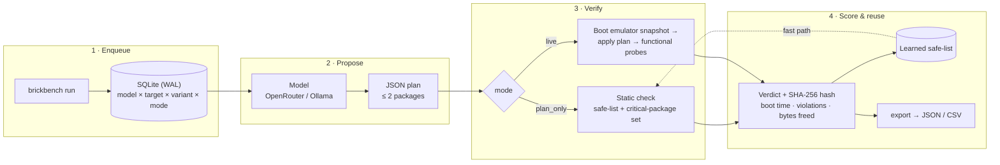

# brickbench

Evaluation harness that benchmarks LLM-recommended Android debloat actions for **safety and correctness** — propose a plan with any model, verify it against real emulator checks, and score it reproducibly.

<!-- Record a ~45s terminal screencast and drop it in docs/ (see "Demo" below):

-->

## How It Works

1. **Enqueue** — `brickbench run` builds a matrix of `(model × ROM target × prompt variant × mode)` runs in SQLite.
2. **Propose** — each run asks the model (OpenRouter or local Ollama) for a minimal JSON debloat plan (≤ 2 packages).
3. **Verify** — the plan is checked two ways:
   - `plan_only` — fast static check against a learned safe-list + critical-package set (no device needed)
   - `live` — boots an Android emulator snapshot, applies the plan, and runs functional probes (`pm list`, `dumpsys`, service check, launcher start)
4. **Score** — boot success, boot time, critical violations, bytes freed, and tokens used are recorded with a SHA-256 result hash; verified verdicts feed the safe-list for future fast-path lookups.
5. **Export** — dump runs + verdicts to JSON/CSV for analysis.

Targets cover AOSP (vanilla/GApps/Play), LineageOS, /e/OS GSI, and an OEM-combined image. Concurrency is semaphore-gated per emulator with atomic run claiming, so parallel workers never double-execute.

## Architecture



The key design choice: a model's output is **never trusted on its own**. Every plan is
scored against reality — either the learned safe-list (cheap) or a booted emulator
(expensive but authoritative) — and every verdict is hashed so results can't silently drift.

## Tech Stack

- **Core:** Python 3.12+, Click CLI, SQLite (WAL) state store
- **Models:** OpenRouter REST API, Ollama (local models)
- **Verification:** Android SDK emulator + ADB, snapshot boot, functional probes
- **Testing:** pytest (unit + emulator-gated integration tests)

## Getting Started

### Prerequisites

- Python 3.12+
- For `live` mode: Android SDK + emulator, an AVD named `bb_aosp36` with a `clean_boot` snapshot, and `adb` on `PATH`
- For local models: `ollama serve`

### Setup

```bash
cp .env.example .env   # set OPENROUTER_API_KEY
pip install -e ".[pdf]" # includes WeasyPrint for PDF reports
```

Optional env overrides: `BRICKBENCH_AVD`, `BRICKBENCH_SNAPSHOT`, `BRICKBENCH_EMU_RAM_MB`.

### Run

```bash
brickbench init                                       # create data/runs + SQLite store
brickbench run --providers openrouter local \         # enqueue evaluation matrix
  --modes plan_only live
brickbench resume --max-emulator 1 --max-llm 4        # execute pending runs
brickbench export --format json --output results.json # dump results
brickbench report --db data/runs/brickbench.db \
  --output dist/index.html                            # render static report
```

### Report

`brickbench report` turns a results database into a **single self-contained HTML
or publication-grade PDF file** — inline CSS with print media formatting, no scripts,
no fonts, no network requests — so it opens directly from disk, prints cleanly to paper,
or publishes as a GitHub Pages artifact.

```bash
brickbench report --output dist/index.html                       # default DB (HTML)
brickbench report --output dist/report.pdf                        # standalone PDF (auto-detected)
brickbench report --db data/fixtures/report_fixture.db \
  --output dist/report.pdf --format pdf                          # explicit PDF format
brickbench report --db data/fixtures/report_fixture.db \
  --output /tmp/report.html                                     # any DB to HTML
brickbench report --db data/fixtures/report_fixture.db \
  --output dist/report.json --format json                       # same data as JSON
```

The query layer lives in `brickbench/report.py`: `collect_report(db)` returns one
canonical dict and `render_html()`, `render_pdf()`, and `render_json()` format it,
so outputs can never disagree.

### Podman & Containerized Execution

brickbench can run completely containerized with Podman without requiring local
Python dependencies or system libraries.

```bash
# Automated end-to-end run (builds image, evaluates matrix or fixture, outputs HTML and PDF to dist/):
./scripts/run_pod.sh

# Pass arbitrary CLI commands through the container:
./scripts/run_pod.sh report --db data/fixtures/report_fixture.db --output dist/report.pdf

# Or run declaratively via Podman / Kubernetes Pod:
podman play kube pod.yaml
podman play kube --down pod.yaml
```

| Field | Meaning |
| ----- | ------- |
| **Safety pass** | `safety_passed` scored runs ÷ all scored runs. A run passes when functional probes and critical-package checks pass. |
| **Critical failures** | Scored runs that removed at least one package from the target's critical set. |
| **Boot delta** | Mean `boot_time_s` change against that target's fastest successful live boot (negative = faster). `plan_only` runs have no boot measurement. |
| **Token spend** | Sum of `tokens_used` across scored runs, plus the mean per run. |
| Scored / enqueued | Runs with a `run_results` row vs. all rows in `runs` (includes `pending` and `skipped`). |
| Per-target table | Runs, scored, safety %, critical failures, mean boot, boot delta, tokens, bytes freed. |
| Per-model table | Scored runs, safety %, critical failures, token total and per run, boot delta. |
| Failures table | Safety/boot failures with the offending critical packages and probe errors. |

`resume` writes one `run_results` row per executed cell (via
`report.record_run_result()`); the JSON report is the same dict the HTML uses:
`schema_version`, `generated_at`, `tool_version`, `database`, `summary`,
`targets`, `models`, `failures`, `verdicts`.

**Fixture.** `data/fixtures/report_fixture.db` is a small, deterministic,
secret-free database used by the tests and by CI when no model credentials are
configured. Regenerate it (never hand-edit it) with:

```bash
python scripts/make_fixture_db.py
```

CI (`.github/workflows/report.yml`) renders the report on every push to `main`
and uploads `dist/` as a Pages artifact. When `OPENROUTER_API_KEY` is present it
first executes three `plan_only` cells against `aosp-vanilla`; otherwise it
renders the fixture so the artifact is always non-empty.

### Test

```bash
pytest -q               # unit tests
pytest -q -m "not slow" # skip emulator-gated tests
```

## Demo

brickbench is a batch harness, not a service — there is no URL to click, and that's
fine. The honest way to show it working is a short terminal recording plus a committed
results table.

```bash
brickbench init
brickbench run --providers openrouter --modes plan_only   # enqueue
brickbench resume --max-llm 2                             # watch runs execute
brickbench export --format csv --output results.csv       # show the results
```

Recording tip: the *interesting* part is a verdict where the model proposed something
unsafe and the harness caught it. Lead with that, not with a happy path.

## CLI Reference

| Command | Description |
| ------- | ----------- |
| `init` | Scaffold `data/runs` and the SQLite schema (`runs`, `verdicts`) |
| `run` | Enqueue the provider × target × mode matrix |
| `resume` | Execute pending runs with emulator/LLM concurrency limits |
| `reset` | Drop results (confirmation required) |
| `export` | Dump runs + verdicts to JSON or CSV |
| `report` | Render a standalone HTML, PDF, or JSON report from a results DB |

## Project Structure

```
brickbench/
├── cli.py        # Click commands: init, run, resume, reset, export, report
├── config.py     # Version, providers, modes, ROM targets, rate limits
├── runner.py     # Run orchestration, model dispatch, concurrency
├── report.py     # Report query layer + HTML/JSON rendering
└── evaluator.py  # Plan verification (static + emulator) and scoring
data/fixtures/    # Deterministic report fixture DB (regenerate via scripts/)
scripts/          # make_fixture_db.py
tests/unit/       # Config, evaluator, and report tests
```
